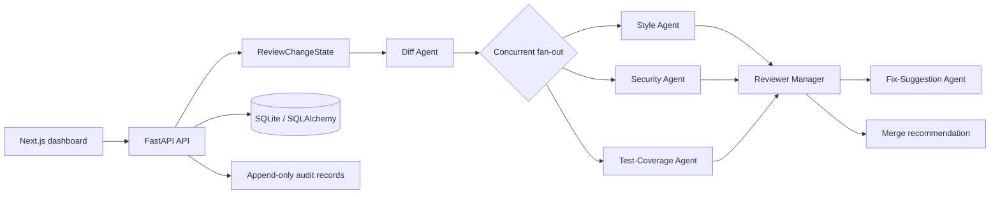

# Automated Code Review Board

**Automated Code Review Board** is an offline-first, multi-agent code review platform for
submitted Git diffs and source archives. It combines independent static-analysis agents with a
reviewer manager that consolidates evidence, applies deterministic merge rules, and produces an
advisory fix suggestion for the most important finding.

The project is designed for local development, demonstrations, and extension into a production
review service. It never executes submitted code, never applies generated patches automatically,
and does not expose detected secrets in reports.

## What the system does

1. Accepts a unified Git diff through the web UI or API.
2. Creates a persisted review and a thread-safe shared change state.
3. Parses changed files, hunks, symbols, and change statistics.
4. Fans out to style, security, and test-coverage agents concurrently.
5. Collects structured findings from every agent.
6. Deduplicates and ranks findings by severity.
7. Generates and syntax-checks an advisory patch for the highest-severity finding.
8. Calculates `APPROVE` or `REQUEST_CHANGES` using explicit rules.
9. Persists findings, agent executions, suggested patches, and audit events in SQLite.
10. Displays the complete review in the Next.js dashboard.

For a detailed explanation of the agentic design, read
[docs/AGENTIC_AI.md](./docs/AGENTIC_AI.md).

## Architecture



## Technology

- **Frontend:** Next.js, React, TypeScript, Tailwind CSS, Lucide React.
- **Backend:** Python, FastAPI, Pydantic, SQLAlchemy, SQLite.
- **Analysis:** Python AST parsing, regular expressions, diff parsing, deterministic heuristics.
- **Operations:** Docker, Docker Compose, Uvicorn, pytest.
- **Integration model:** offline deterministic mode is the working default; external model
  credentials are optional configuration for future adapters.

## Repository layout

```text
backend/
  agents/       Specialist agents and the reviewer manager
  api/          FastAPI routes
  core/         Shared state, configuration, and audit logging
  models/       SQLAlchemy persistence and Pydantic schemas
  sample_data/  Clean and vulnerable demonstration inputs
  tests/        Agent, recommendation, and API tests
frontend/
  src/app/      Landing, dashboard, review, history, results, and settings pages
  src/components/ Reusable UI components
  src/lib/      API client and TypeScript contracts
docs/
  AGENTIC_AI.md Agentic architecture and implementation guide
notebooks/
  demo_trace.ipynb  End-to-end offline execution trace
```

## Run locally on Windows

### 1. Start the backend

```powershell
cd D:\coding\projects\agentic-ca2\backend
python -m venv .venv
.\.venv\Scripts\Activate.ps1
pip install -r requirements.txt
uvicorn main:app --reload
```

The API and interactive OpenAPI documentation are available at
`http://localhost:8000` and `http://localhost:8000/docs`.

### 2. Start the frontend

Open a second PowerShell terminal:

```powershell
cd D:\coding\projects\agentic-ca2\frontend
npm install
npm run dev
```

Open `http://localhost:3000`, select **New Review**, and submit a diff. The default frontend API
target is `http://localhost:8000`; override it with `NEXT_PUBLIC_API_URL`.

### 3. Run the tests

```powershell
cd D:\coding\projects\agentic-ca2\backend
python -m pytest -q
```

The suite covers clean and vulnerable reviews, secret redaction, diff parsing, duplicate
resolution, recommendation logic, patch syntax validation, health checks, and persisted
end-to-end reviews.

## API surface

| Method | Endpoint | Purpose |
|---|---|---|
| `GET` | `/api/health` | Service and database health |
| `POST` | `/api/reviews` | Submit diff or source text |
| `POST` | `/api/reviews/diff` | Diff-specific submission alias |
| `POST` | `/api/reviews/upload` | Inspect a UTF-8 ZIP without executing files |
| `GET` | `/api/reviews` | List saved reviews |
| `GET` | `/api/reviews/{review_id}` | Get a complete review |
| `GET` | `/api/reviews/{review_id}/findings` | List or filter findings |
| `GET` | `/api/reviews/{review_id}/agents` | Get agent execution records |
| `GET` | `/api/reviews/{review_id}/logs` | Get audit events |
| `GET` | `/api/reviews/{review_id}/report` | Get a report-shaped JSON response |

## Configuration

Copy `.env.example` to `.env` when local overrides are needed:

| Variable | Default | Description |
|---|---|---|
| `OFFLINE_MODE` | `true` | Keeps analysis deterministic and key-free |
| `DATABASE_URL` | `sqlite:///./code_review.db` | SQLAlchemy database URL |
| `NEXT_PUBLIC_API_URL` | `http://localhost:8000` | Browser-visible API origin |
| `MAX_FILE_SIZE_MB` | `10` | Maximum uploaded archive size |
| `MAX_FINDINGS_PER_AGENT` | `50` | Intended finding cap |
| `CRITICAL_THRESHOLD` | `1` | Configuration value for critical policy |
| `HIGH_SECURITY_THRESHOLD` | `1` | Configuration value for high-security policy |

API keys must remain in environment variables and must never be committed or returned by an API
response.

## Decision policy

The reviewer manager returns `REQUEST_CHANGES` when there is:

- Any `CRITICAL` finding.
- Any `HIGH` security or secret-exposure finding.
- At least three `HIGH` findings.
- At least five `MEDIUM` findings.

Otherwise, it returns `APPROVE`. The response includes the reason and the blocking finding IDs.
This is an automated recommendation, not a security guarantee or a substitute for human review.

## Safety and limitations

- Submitted source is analyzed as text; it is not imported, executed, or run as a subprocess.
- Secret evidence is redacted before it becomes a finding.
- Suggested patches are advisory and are never applied automatically.
- Test coverage is a static estimate, not coverage measured by pytest-cov or another runtime tool.
- The checked-in implementation uses deterministic local analyzers. Semantic Kernel or an external
  LLM adapter is not required for the current workflow; an adapter can be added behind the
  existing specialist/manager contracts.
- If an agent fails, the review is marked `FAILED` and the error is recorded instead of being
  represented as a successful review.

## Demonstration inputs

- `backend/sample_data/clean_code.py` demonstrates a review that should avoid blocking findings.
- `backend/sample_data/vulnerable_code.py` and its diff demonstrate secret and unsafe-pattern
  detection.
- `notebooks/demo_trace.ipynb` prints the manager output and per-agent execution status.
