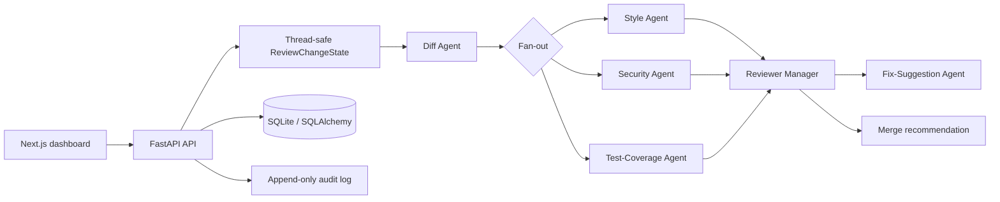

# Automated Code Review Board

Automated Code Review Board is an offline-first FastAPI and Next.js application that reviews
unified Git diffs with independent static-analysis agents. It identifies security, correctness,
style, and test-coverage concerns, then a reviewer manager deduplicates findings and applies
deterministic merge rules. Suggested patches are advisory only and never modify submitted code.

## Architecture



Agents use separate modules and tools: Diff parses diffs and changed symbols; Style runs style
analysis and duplication detection; Security scans secrets and vulnerability patterns; Coverage
discovers tests and estimates coverage; Fix Suggestion generates and syntax-validates an advisory
patch; Manager aggregates findings and calculates the decision. Static analysis is deterministic
and does not execute submitted code. Coverage is explicitly estimated, not runner-measured.

## Run on Windows

```powershell
cd D:\coding\projects\agentic-ca2\backend
python -m venv .venv
.\.venv\Scripts\Activate.ps1
pip install -r requirements.txt
uvicorn main:app --reload
```

In another terminal:

```powershell
cd D:\coding\projects\agentic-ca2\frontend
npm install
npm run dev
```

Open `http://localhost:3000`, choose **New Review**, and submit the included sample diff or
paste your own. The API is documented at `http://localhost:8000/docs`.

Run backend tests with `python -m pytest -q` from `backend`. Set `OFFLINE_MODE=false` only when
an external model adapter is configured; the checked-in implementation is fully functional
without a paid API key. `DATABASE_URL` can point at another SQLAlchemy-supported database.

One honest failure mode is surfaced: if an agent raises an exception, its execution is marked
`FAILED`, the review is marked `FAILED`, and the error is recorded in the audit trail instead of
being converted into a successful-looking report.
